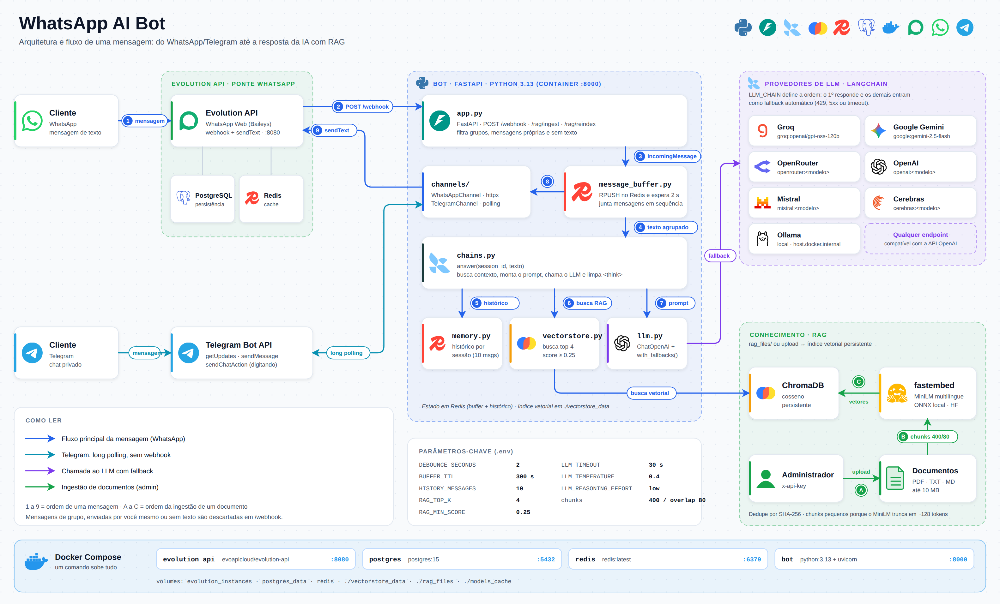

<div align="center">

# WhatsApp AI Bot

**Chatbot de atendimento para WhatsApp e Telegram com IA, RAG e deploy em um comando**

[](https://www.python.org/)
[](https://fastapi.tiangolo.com/)
[](https://www.langchain.com/)
[](https://www.trychroma.com/)
[](https://redis.io/)
[](https://www.postgresql.org/)
[](https://www.docker.com/)
[](https://www.whatsapp.com/)
[](https://core.telegram.org/bots)

[Arquitetura](#-arquitetura) • [Recursos](#-recursos) • [Instalação](#-instalação) • [Configuração](#-configuração) • [RAG](#-base-de-conhecimento-rag) • [API](#-endpoints) • [Segurança](#-segurança)

</div>

---

## Sobre o projeto

Bot de atendimento que recebe mensagens no **WhatsApp** (via [Evolution API](https://doc.evolution-api.com/)) e no **Telegram**, consulta uma base de conhecimento própria (PDF, TXT e MD) e responde com um LLM de sua escolha, mantendo o histórico de cada conversa.

Funciona com qualquer provedor de API compatível com OpenAI (Groq, Google Gemini, OpenRouter, OpenAI, Mistral, Cerebras e Ollama local), com **fallback automático** entre eles: se o primeiro falhar por limite de requisição, erro 5xx ou timeout, o próximo da lista assume.

**Casos de uso:** atendimento ao cliente, FAQ de produtos e serviços, pré-vendas e qualificação de leads, suporte técnico e dúvidas internas (RH, treinamento).

---

## Arquitetura

<div align="center">

[](docs/architecture.svg)

<sub>Clique na imagem para abrir a versão em SVG.</sub>

</div>

### Caminho de uma mensagem

| # | Etapa | Onde |
|---|-------|------|
| 1 | Cliente envia a mensagem no WhatsApp | Evolution API (ponte com o WhatsApp Web) |
| 2 | Evolution chama `POST /webhook` com o evento `MESSAGES_UPSERT` | `app.py` |
| 3 | Descarta grupos, mensagens enviadas pelo próprio número e mensagens sem texto; cria um `IncomingMessage` | `app.py`, `channels/base.py` |
| 4 | Guarda o texto numa lista no Redis e espera `DEBOUNCE_SECONDS`; se chegar outra mensagem nesse intervalo, o timer reinicia e tudo é juntado numa só | `message_buffer.py` |
| 5 | Carrega as últimas `HISTORY_MESSAGES` mensagens da sessão | `memory.py` (Redis) |
| 6 | Busca os `RAG_TOP_K` trechos mais parecidos no ChromaDB e mantém só os com score ≥ `RAG_MIN_SCORE`. Mensagens curtas (menos de 6 palavras) são unidas à pergunta anterior para não perder o assunto | `chains.py`, `vectorstore.py` |
| 7 | Monta o prompt (system + trechos + histórico + pergunta) e chama o LLM, com fallback entre os provedores do `LLM_CHAIN` | `llm.py` |
| 8 | Remove blocos `<think>`, salva a troca no histórico e entrega a resposta ao canal de origem | `chains.py`, `channels/` |
| 9 | O canal envia: `POST /message/sendText` na Evolution API (WhatsApp) ou `sendMessage` na Bot API (Telegram) | `channels/whatsapp.py`, `channels/telegram.py` |

**Telegram** não usa webhook: o bot faz *long polling* (`getUpdates`) numa tarefa iniciada junto com a aplicação, atende só chats privados, responde `/start` com `WELCOME_MESSAGE` e mostra "digitando…" enquanto a IA processa. O canal só é ativado se `TELEGRAM_BOT_TOKEN` estiver preenchido.

---

## Recursos

| Recurso | Descrição |
|---------|-----------|
| **Multi-canal** | WhatsApp (Evolution API) e Telegram, com a mesma lógica de IA. Novo canal = uma classe em `channels/` |
| **Multi-LLM com fallback** | `LLM_CHAIN` define a ordem dos modelos; falhou, cai para o próximo |
| **RAG local** | Embeddings multilíngues rodando na própria máquina (fastembed + ONNX), sem custo de API de embeddings |
| **Ingestão por upload ou pasta** | Envie arquivos por `POST /rag/ingest` ou solte em `rag_files/`; reindexe com `POST /rag/reindex` |
| **Deduplicação** | Arquivos já indexados são ignorados (hash SHA-256); reenviar o mesmo nome substitui a versão anterior |
| **Debounce de mensagens** | Quem manda várias mensagens seguidas recebe uma única resposta |
| **Memória por conversa** | Histórico em Redis, separado por canal e por contato |
| **Prompt configurável** | Persona e regras de atendimento no `.env`, sem mexer em código |
| **Assíncrono** | FastAPI + httpx + asyncio; chamadas bloqueantes rodam em threads |
| **Deploy simples** | Evolution API, PostgreSQL, Redis e o bot sobem com `docker compose up -d` |

---

## Stack

| Camada | Tecnologia |
|--------|------------|
| API | [FastAPI](https://fastapi.tiangolo.com/) + Uvicorn, Python 3.13 |
| Orquestração de IA | [LangChain](https://www.langchain.com/) (`langchain-openai`, `langchain-chroma`) |
| LLMs | Groq, Google Gemini, OpenRouter, OpenAI, Mistral, Cerebras, Ollama (todos via API compatível com OpenAI) |
| Embeddings | [fastembed](https://github.com/qdrant/fastembed) com `paraphrase-multilingual-MiniLM-L12-v2` (ONNX, local) |
| Banco vetorial | [ChromaDB](https://www.trychroma.com/) (métrica cosseno, persistente em disco) |
| Memória e buffer | [Redis](https://redis.io/) |
| WhatsApp | [Evolution API](https://doc.evolution-api.com/) + PostgreSQL |
| Telegram | Bot API (long polling) |
| Infra | Docker e Docker Compose |

---

## Estrutura do projeto

```text
whatsapp_ai_bot/
├── app.py               # FastAPI: /webhook, /rag/ingest, /rag/reindex, polling do Telegram
├── chains.py            # answer(): histórico + RAG + prompt + LLM
├── llm.py               # monta o LLM_CHAIN com fallbacks (ChatOpenAI)
├── message_buffer.py    # buffer no Redis + debounce + envio da resposta
├── memory.py            # histórico de conversa (RedisChatMessageHistory)
├── vectorstore.py       # ingestão, chunking, reindex e busca no ChromaDB
├── embeddings.py        # embeddings locais (fastembed)
├── config.py            # leitura das variáveis de ambiente
├── channels/
│   ├── __init__.py      # registro de canais
│   ├── base.py          # IncomingMessage e protocolo Channel
│   ├── whatsapp.py      # envio via Evolution API
│   └── telegram.py      # polling + envio via Bot API
├── rag_files/           # documentos da base de conhecimento
│   └── processed/       # arquivos já indexados
├── vectorstore_data/    # índice do ChromaDB (volume)
├── models_cache/        # modelo de embeddings baixado (volume)
├── docs/                # diagrama de arquitetura
├── docker-compose.yml
├── Dockerfile
├── requirements.txt
└── .env.example
```

---

## Pré-requisitos

- [Docker](https://docs.docker.com/get-docker/) 20.10+ e [Docker Compose](https://docs.docker.com/compose/install/) 2.0+
- [Git](https://git-scm.com/downloads)
- Uma chave de API de pelo menos um provedor de LLM (Groq e Google Gemini têm plano gratuito)
- Um número de WhatsApp para conectar (de preferência dedicado ao bot)
- Opcional: token de um bot do Telegram (via [@BotFather](https://t.me/BotFather))

---

## Instalação

### 1. Clonar e configurar

```bash
git clone <url-do-repositorio>
cd whatsapp_ai_bot
cp .env.example .env
```

Edite o `.env` e preencha, no mínimo:

- `LLM_CHAIN` e a chave do provedor escolhido (ex.: `GROQ_API_KEY`)
- `AUTHENTICATION_API_KEY`: chave de acesso da Evolution API (invente uma forte)
- `EVOLUTION_INSTANCE_NAME`: nome da instância do WhatsApp
- `ADMIN_API_KEY`: chave dos endpoints de RAG
- `AI_SYSTEM_PROMPT`: persona e regras do seu atendimento

### 2. Subir os containers

```bash
docker compose up -d --build
docker compose logs -f bot
```

Na primeira execução o modelo de embeddings (~250 MB) é baixado para `models_cache/`. Aguarde o log do `bot` indicar que o Uvicorn está rodando na porta 8000.

### 3. Criar a instância e conectar o WhatsApp

```bash
curl -X POST http://localhost:8080/instance/create \
  -H "apikey: SUA_AUTHENTICATION_API_KEY" \
  -H "Content-Type: application/json" \
  -d '{"instanceName":"minha-instancia","qrcode":true,"integration":"WHATSAPP-BAILEYS"}'
```

O `instanceName` precisa ser igual ao `EVOLUTION_INSTANCE_NAME` do `.env`. Para ler o QR Code, abra o painel em `http://localhost:8080/manager`, entre com a `AUTHENTICATION_API_KEY` e escaneie em **WhatsApp > Aparelhos conectados**.

### 4. Apontar o webhook para o bot

```bash
curl -X POST http://localhost:8080/webhook/set/minha-instancia \
  -H "apikey: SUA_AUTHENTICATION_API_KEY" \
  -H "Content-Type: application/json" \
  -d '{"webhook":{"enabled":true,"url":"http://bot:8000/webhook","events":["MESSAGES_UPSERT"]}}'
```

> O formato do payload pode variar entre versões da Evolution API. Se preferir, configure o mesmo webhook (URL `http://bot:8000/webhook`, evento `MESSAGES_UPSERT`) pelo painel `/manager`, ou use as variáveis globais `WEBHOOK_GLOBAL_*` comentadas no `.env.example`.

Pronto: mande uma mensagem para o número conectado e acompanhe com `docker compose logs -f bot`.

---

## Configuração

Todas as opções ficam no `.env`. As principais:

| Variável | Padrão | Descrição |
|----------|--------|-----------|
| `LLM_CHAIN` | (vazio) | Lista `provedor:modelo` separada por vírgula. O 1º responde, os demais são fallback. Obrigatória |
| `LLM_TEMPERATURE` | `0` | Criatividade das respostas (o `.env.example` sugere `0.4`) |
| `LLM_TIMEOUT` | `30` | Segundos até desistir de um modelo e passar ao próximo |
| `LLM_REASONING_EFFORT` | (vazio) | `low`, `medium` ou `high` para modelos de raciocínio |
| `*_API_KEY` | (vazio) | `OPENAI`, `GROQ`, `GOOGLE`, `OPENROUTER`, `MISTRAL`, `CEREBRAS`. Provedor sem chave é ignorado |
| `OLLAMA_BASE_URL` | `http://host.docker.internal:11434/v1` | Endpoint do Ollama local |
| `AI_SYSTEM_PROMPT` | (vazio) | Prompt do sistema. `{context}` recebe os trechos do RAG |
| `HISTORY_MESSAGES` | `10` | Mensagens anteriores enviadas ao modelo |
| `RAG_TOP_K` | `4` | Trechos buscados no banco vetorial |
| `RAG_MIN_SCORE` | `0.25` | Similaridade mínima (0 a 1) para usar um trecho |
| `DEBOUNCE_SECONDS` | `2` no `.env.example` | Silêncio necessário antes de responder |
| `BUFFER_TTL` | `300` | Validade do buffer no Redis, em segundos |
| `TELEGRAM_BOT_TOKEN` | (vazio) | Ativa o canal Telegram |
| `WELCOME_MESSAGE` | `Olá! Como posso ajudar?` | Resposta ao `/start` no Telegram |
| `ADMIN_API_KEY` | (vazio) | Protege os endpoints `/rag/*` |
| `EVOLUTION_API_URL` | `http://evolution-api:8080` | URL interna da Evolution API |
| `EVOLUTION_INSTANCE_NAME` | (vazio) | Nome da instância do WhatsApp |
| `AUTHENTICATION_API_KEY` | (vazio) | Chave da Evolution API (usada também pelo bot para enviar mensagens) |

### Escolhendo os modelos

```env
# Só Groq, com modelo menor de reserva
LLM_CHAIN=groq:openai/gpt-oss-120b,groq:openai/gpt-oss-20b

# Provedores diferentes: se um estourar o limite, passa para o próximo
LLM_CHAIN=groq:llama-3.3-70b-versatile,google:gemini-2.5-flash,openrouter:meta-llama/llama-3.3-70b-instruct:free

# Modelo local
LLM_CHAIN=ollama:llama3.1
```

---

## Base de conhecimento (RAG)

Formatos aceitos: **`.pdf`**, **`.txt`** e **`.md`**.

**Por upload (recomendado):**

```bash
curl -X POST http://localhost:8000/rag/ingest \
  -H "x-api-key: SUA_ADMIN_API_KEY" \
  -F "file=@catalogo.pdf"
```

Resposta: `{"file":"catalogo.pdf","status":"indexed","chunks":42}`. O limite é de 10 MB por arquivo e o status pode ser `indexed` ou `duplicate` (conteúdo idêntico já indexado).

**Por pasta:** coloque os arquivos em `rag_files/` e reinicie o bot (`docker compose restart bot`). Ao iniciar, ele move os arquivos para `rag_files/processed/` e os indexa.

**Reindexar tudo** (após editar ou remover arquivos em `processed/`):

```bash
curl -X POST http://localhost:8000/rag/reindex -H "x-api-key: SUA_ADMIN_API_KEY"
```

**Dicas para respostas melhores**

- Escreva o conteúdo em blocos curtos e autoexplicativos, um assunto por parágrafo. O texto é cortado em chunks de 400 caracteres (overlap de 80) porque o modelo de embeddings trunca em cerca de 128 tokens.
- Use títulos claros ("Preços", "Prazos", "Formas de pagamento"): eles ajudam a busca.
- Se o bot diz "não sei" para algo que está nos documentos, reduza `RAG_MIN_SCORE`. Se traz trechos irrelevantes, aumente.
- Os logs mostram, a cada resposta, as fontes usadas e os scores da busca.

---

## Endpoints

| Método | Rota | Auth | Descrição |
|--------|------|------|-----------|
| `POST` | `/webhook` | nenhuma | Recebe eventos `MESSAGES_UPSERT` da Evolution API |
| `POST` | `/rag/ingest` | `x-api-key` | Envia e indexa um documento (`multipart/form-data`, campo `file`) |
| `POST` | `/rag/reindex` | `x-api-key` | Apaga e reconstrói o índice a partir de `rag_files/processed/` |
| `GET` | `/docs` | nenhuma | Swagger gerado pelo FastAPI |

---

## Serviços e portas

| Container | Imagem | Porta | Função |
|-----------|--------|-------|--------|
| `bot` | build local (`python:3.13`) | 8000 | Aplicação FastAPI |
| `evolution_api` | `evoapicloud/evolution-api` | 8080 | Ponte com o WhatsApp Web |
| `postgres` | `postgres:15` | 5432 | Dados da Evolution API |
| `redis` | `redis:latest` | 6379 | Cache da Evolution, buffer e histórico do bot |

Volumes mapeados no `bot`: `./vectorstore_data`, `./rag_files` e `./models_cache`.

---

## Segurança

Antes de ir para produção:

- **Nunca versione o `.env`** (já está no `.gitignore`). Se alguma chave vazou, revogue e gere outra.
- **O `/webhook` não valida a origem** da requisição. Não exponha a porta 8000 diretamente à internet: deixe o bot acessível só pela rede interna do Docker (a Evolution chama `http://bot:8000/webhook`) ou coloque um proxy reverso com restrição de acesso.
- Use `ADMIN_API_KEY` longa e aleatória; sem ela os endpoints `/rag/*` ficam desativados (503).
- O `docker-compose.yml` publica as portas 5432, 6379 e 8080 no host. Em servidor, remova o mapeamento de `postgres` e `redis`, troque a senha padrão do Postgres e proteja a 8080.
- Use `AUTHENTICATION_API_KEY` forte: ela controla toda a Evolution API.
- O bot responde a qualquer contato que escrever no número conectado. Ajuste o `AI_SYSTEM_PROMPT` para limitar o escopo e nunca ponha dados sensíveis na base de conhecimento.

---

## Solução de problemas

| Sintoma | O que verificar |
|---------|-----------------|
| Bot não responde no WhatsApp | O webhook está configurado? O QR foi escaneado? O `EVOLUTION_INSTANCE_NAME` bate com o nome da instância? Veja `docker compose logs -f bot` |
| `LLM_CHAIN vazio ou sem nenhuma API key válida` | Preencha `LLM_CHAIN` e a chave do provedor correspondente; provedor sem chave é ignorado |
| Respostas genéricas ou "não sei" | Veja os scores no log; ajuste `RAG_MIN_SCORE` e confira se o documento foi indexado |
| Responde a cada mensagem separadamente | Aumente `DEBOUNCE_SECONDS` |
| `503 ADMIN_API_KEY não configurada` | Defina `ADMIN_API_KEY` no `.env` e reinicie o bot |
| Primeira inicialização lenta | Download do modelo de embeddings; fica salvo em `models_cache/` |
| Telegram não responde | Confirme `TELEGRAM_BOT_TOKEN` e converse em chat privado (grupos são ignorados) |

---

## Desenvolvimento local (sem Docker para o bot)

```bash
python -m venv .venv
source .venv/bin/activate        # Windows: .venv\Scripts\activate
pip install -r requirements.txt
```

Suba apenas a infraestrutura (`docker compose up -d evolution-api postgres redis`), ajuste no `.env` as URLs para `localhost` (`CACHE_REDIS_URI=redis://localhost:6379/6`, `EVOLUTION_API_URL=http://localhost:8080`) e rode:

```bash
uvicorn app:app --reload --port 8000
```

Nesse modo, o webhook da Evolution deve apontar para `http://host.docker.internal:8000/webhook`.

---

## Autor

Desenvolvido por **BRAGGA DEV** · Jequié, Bahia, Brasil.